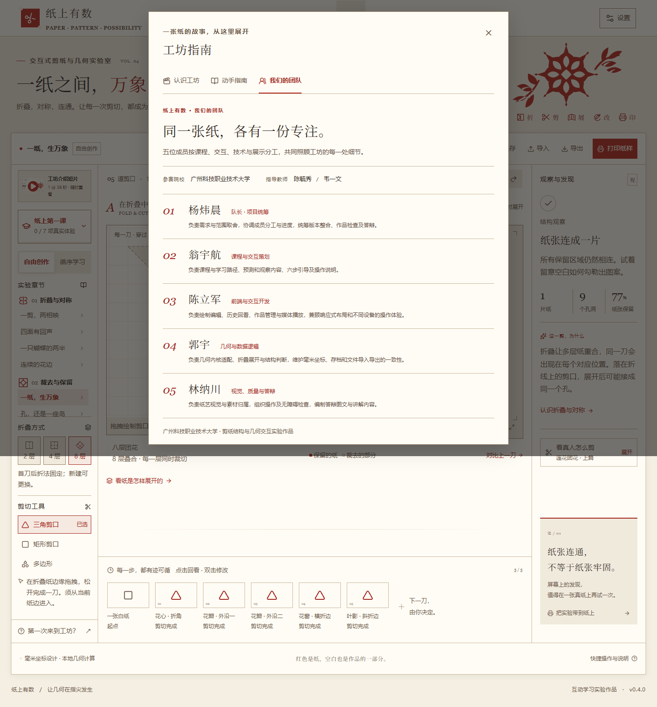

# GitHub 公开版发布说明

核查日期：2026-10-26。此目录保存本次公开发布的真实运行截图；不是效果概念图。

## 同步与变更

- 以远端 `master` 的 `5ab4efad52f52fbc842815199d096f57c696d446` 为基线。
- 只在隔离发布副本中整合本机已完成的团队页：`WorkshopGuide.tsx`、`workshop-intro.ts`、`guide.css`。未修改或替用户提交本机工作区。
- 运行时图片、介绍片、字幕和音乐使用 Vite `BASE_URL`，支持 GitHub Pages 仓库子路径。
- 补充原创介绍片及封面、字幕，四首 CC BY 4.0 音乐及原创几何封面。来源、改编、作者与许可见 [完整登记](../content-sources.md)。
- 五段许可未确认的第三方本地教学摘录不进入公开仓库；保留官方嵌入与文字步骤，不提供缺失文件的播放入口。
- GitHub Actions 从锁文件安装、运行单测、生产构建后将 `dist-v4` 发布到 Pages。

## 截图

截图在本机 Chrome 无头浏览器中，以 `/zhishang-youshu/` 仓库子路径加载本次生产构建生成；未包含账号、账户数据或私人配置。

## 验证边界

本次检查覆盖生产构建、单元测试、对比度护栏、仓库子路径的图片与媒体资源、团队页及页面异常。GitHub 线上最终部署结果由发布后的 Actions/Pages 状态确认；本地截图不等于线上部署成功。历史双浏览器结果是各自版本的记录，本次不冒用其测试数量。

## 资产许可

站点原创代码的正式开放协议由仓库发布人统一设置；第三方组件、字体、音乐、音效及外站教程始终适用各自协议。不能用一份根目录代码许可覆盖所有第三方媒体。请同时保留 `THIRD_PARTY_NOTICES.md`、`public/third-party-notices.txt` 与来源登记。
